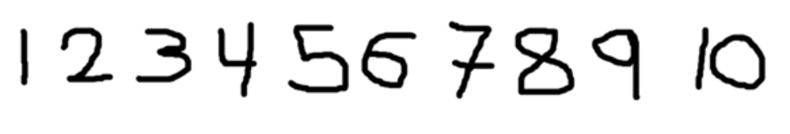
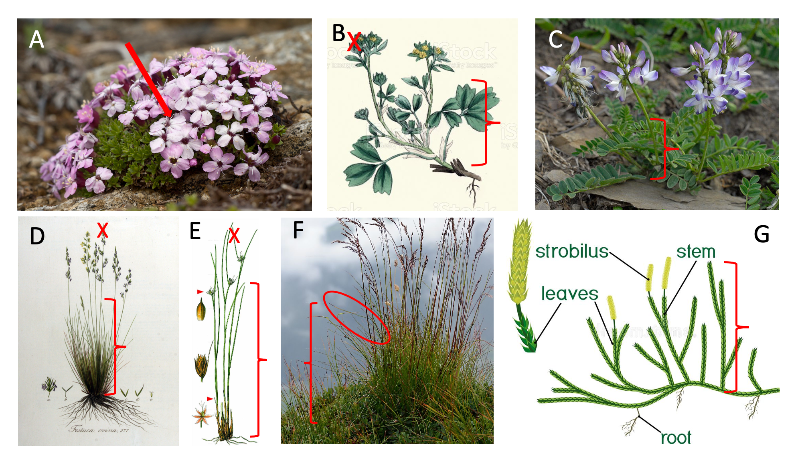
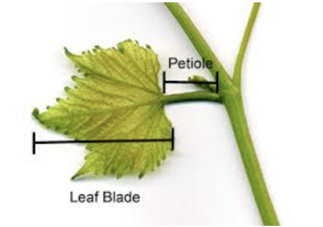
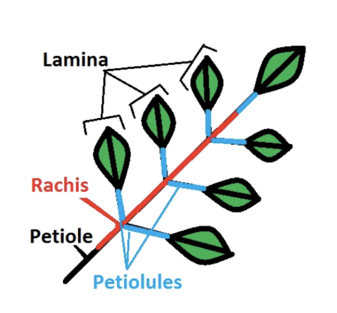
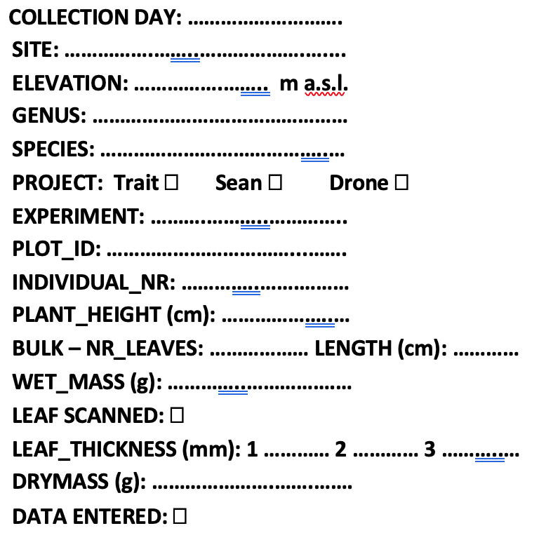
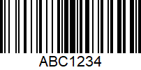
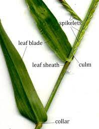
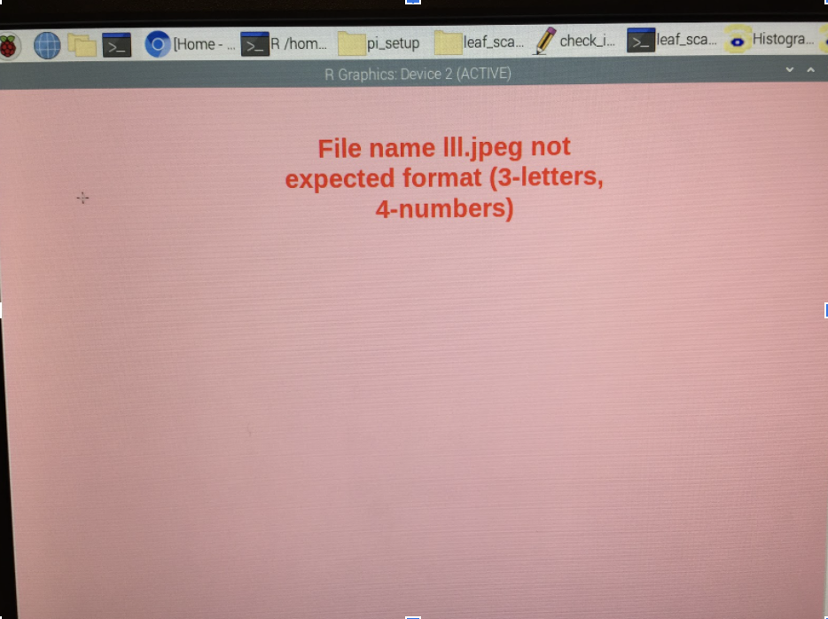
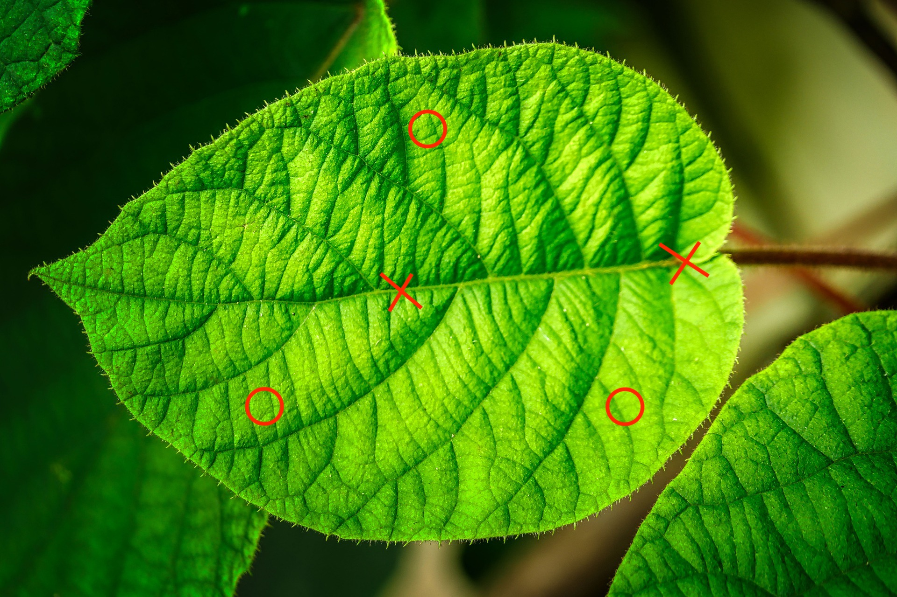

```{r setup, include=FALSE}
knitr::opts_chunk$set(echo = FALSE)

library(tidyverse)
library(kableExtra)
```

# The trait wheel

```{=html}
<div class="model-signs" aria-label="Where this sits in the PFTC model">
<span class="sign sign-create">Create</span>
<span class="sign sign-process">Process</span>
<span class="sign sign-share">Share</span>
<span class="sign sign-data">Data documentation</span>
<span class="sign sign-methods">Methods and technology</span>
</div>
```

This protocol shows how to collect, measure, check and document leaf functional traits for vascular plants using the trait wheel^TW^ (@fig-trait-wheel).
The protocol is based on the trait handbook from Perez-Harguindeguy et al. [-@Perez-Harguindeguy2013-nv].

::: {#fig-trait-wheel .column-page fig-alt="A semicircular trait wheel. Blue steps are done while the leaf is still wet. Brown steps are done after the leaf is dry."}
```{=html}

```

The steps of the trait wheel.
:::

## Pre-field preparation

Things that should be figured out before going to the field:
- sampling design (how many species, plants per plot, how many leaves per plant)
- how much biomass is needed for chemical traits
- how to write numbers
- equipment to bring to the field
- define how traits are measured on different species, discuss special casses beforehand. Make a list of rulse.
- create barcode stickers and labels for the envelopes


**Sampling design**

Plants and leaves are collected from permanently marked plots.
The plot size will depend on the vegetation type and can vary between 25 x 25cm^2^ to 100 x 100cm^2^.

We aim to collect leaves from species that make up ca. 80% of the cover in each plot.
If we have species cover data from each plot, then we can generate a species list per plot before going to the field.

Below is an example code to generate such a species list with a threshold of 80%. The dataset should contain the following columns: turfID, species, and cover, where turfID is a unique plot identifier and cover is the cover of each species per plot.

```{r cumsum, eval=FALSE, echo=TRUE}

threshold <-  80

cover |> 
  select(turfID, species, cover) |> 
  group_by(turfID) |> 
  arrange(turfID, -cover) |> 
  mutate(cumsum = cumsum(cover)) |> 
  filter(cumsum <= threshold)

```

Create a species list per plot that can be ticked off to bring to the field to make the sampling more efficient.

Decide if the plants can be collected inside the plot (destructuve sampling) or outside the plot (non-destructive sampling).


**Legit numbers**

Deside on how to write numbers, so that everybody is using the same system.
In the PFTC course, the only approved way is shown in (@fig-numbers).

```{r}
#| label: fig-numbers
#| fig-cap: "The one and only approved way to write numbers!"
#| fig-alt: "Illustrations for the one and only approved way to write numbers!"



```

**What to bring to the field:**
- Species list
- Measuring stick
- Zip-loc bag
- Water proof pen
- Map of experimental site and design

**Field rules**

When in the field, be careful at all time when working in the experiment and avoid stepping on the experimental plots, markers, and measuring devices.
Make yourself familiar with the experimental design (check the site maps), and how plot, blocks and sites are marked before entering the site.

To collect plants, go to one plot and use a sitting mat to sit next to the plot to avoid disturbing the vegetation surrounding the plot.

**Select individuals**

For each plot and species find 3 individuals that are spread across the plot to avoid sampling clones.

Choose reproductively mature adults with fully expanded leaves (i.e. not seedlings) and healthy-looking leaves (i.e. not grazed, no signs of pathogen or herbivore attack, no discoloration).

Measure the height of each individual plant and note down the height on the zip-loc bag (see below).


## Plant height {#plant-height .step-height .phase-wet}

Measure the vegetative height of the plants in the field (@fig-height).
Vegetative height is the shortest distance between the main photosynthetic tissue on the plant and the ground, excluding any reproductive structure (e.g. buds, flowers or fruits).
Leave the plant in it's natural form and do not stretch the plant if it bends.

Plant have different structures and plant height is not alwyays the same.
@fig-height shows some typical plant structures and how to measure height.
For cushion plants (A), stick a the ruler into the cusion all the way to the ground.
For forbs and graminoids (B, D, E) measure the main stem leaves, and do not stretch the leaves if they bend(D, F, G).

```{r}
#| label: fig-height
#| fig-cap: "Different plant types and how to measure height."
#| fig-alt: "Different plant types and how to measure height."



```

Note down the height on the zip-loc bag using.

## Collect {#collecting-leaves-in-the-field .step-leaf .phase-wet}

Collect 1 leaf from each individual plant per plot.
Collect the leaf including the petiole and leaflets (@fig-leaf-anatomy, @fig-leaflets).
Make sure that all data collectors understand the anatomy of each plant species and know what to collect.

If the leaves for a species are very small, make a rule for how many leaves should be collected per indiviudal.

If you cannot find 3 individuals of each species, that is ok.
After a reasonable search, move on to the next species or plot.

::: {#fig-grasslands layout-ncol="2"}
{#fig-leaf-anatomy}

{#fig-leaflets}

Leaf atanomy
:::

Place the leaf/leaves for each individual in a bag with wet paper towels for transfer to lab.

```{r}
#| label: fig-zip-loc
#| fig-cap: "Sticker for Zip-loc bag"
#| fig-alt: "Sticker for Zip-loc bag"
#| eval: false
#| echo: false

knitr::include_graphics("images/trait_wheel/ziploc_label.png")

```

## Prepare {#preparing-leaves-for-measuring-traits-in-lab .step-envelope .phase-wet}

Select one leaf per individual.
For analysing chemical traits such as percent P, C, N and isotopes, a certain amount of dry biomass is needed.
Make sure that we are collecting 0.03 g (30 mg) dried leaf material.
Otherwise select several leaves until there is enough dry weight.
This is called a bulk sample and should be indicated on the envelope (e.g. count the nr of leaves).

When collecting the leaf, include petiole and rachis (@fig-leaflets).
Pat the leaf dry with a tissue if there is visible water on the surface.
Add a sticker to enter the information and a barcode sticker to the envelope (@fig-label and @fig-barcode).
Attach the sticker with a stapler.

::: {#fig-label layout-ncol="2"}


{#fig-barcode}

Sticker and barcode example.
:::

::: callout-note
## How IDs and barcodes are generated

For more information on how the unique leaf IDs and barcode stickers are generated, see the readme file in this [GitHub repo](https://github.com/Plant-Functional-Trait-Course/PFTCFunctions).
:::

Fill in all information between 'collection day' and 'Bulk nr/length'.
Carefully, check @tbl-info for the different options for the information on the label.

Place the leaf inside the envelope and put the envelope in a box for the next step.
Make sure the envelopes are kept wet at all times.

::: {#tbl-info}

```{=html}
<div class="envelope-label">
  <div class="el-line"><span class="el-key">Date</span><span class="el-fill">add day, e.g. 6</span></div>
  <div class="el-line"><span class="el-key">siteID</span><span class="el-fill">Number 1-5</span></div>
  <div class="el-line"><span class="el-key">Aspect</span><span class="el-fill">East / West (circle)</span></div>
  <div class="el-line"><span class="el-key">Species (genus and species)</span><span class="el-fill">Bistorta vivipara</span></div>
  <div class="el-line"><span class="el-key">Project</span><span class="el-fill">T = trait, S = spectroscophy, R = roots, P = photosynthesis</span></div>
  <div class="el-line"><span class="el-key">PlotID</span><span class="el-fill">Number 1-5</span></div>
  <div class="el-line"><span class="el-key">PlantID</span><span class="el-fill">Number 1-3</span></div>
  <div class="el-line"><span class="el-key">Height cm</span><span class="el-fill">Number</span></div>
  <div class="el-line"><span class="el-key">Bulk nr</span><span class="el-fill">Number if multiple leaves were samples</span></div>
</div>
```

Information to write on the envelope.
:::

::: callout-warning
## Warning for special cases.

Carefully check the rules for how to measure special plant species plants.

- *xx sp* have tightly rolled leaves and they should not be unfolded for the scanning.
- *xx sp* have tiny leaves. Choose a 10 cm piece of stem and scrape of all the leaves from this part for scanning. Make sure the leaves do not overlap
:::

## Wet mass {#wet-mass .step-balance .phase-wet}

Make sure the envelopes are still kept wet.
Weigh each leaf and write the weight on the envelope, including all digits.

## Leaf area {#measure-leaf-area-using-a-scanner .step-scanner .phase-wet}

For scanning the leaves we are using a Rasperry Pi setup.
The Pis control the scanners, ensuring consistency, and validate file names. 

::: callout-note
## Raspberry Pi setup

For more information on the Raspberry Pi setup, see the readme file in this [GitHub repo](https://github.com/Plant-Functional-Trait-Course/pi_setup).
:::

*Start setup*

Connect your Laptop to the Raspberry PI. Connect the PI with an ethernet cable to your laptop.
Connect the scanner to the PI.
Connect the barcode scanner to the PI.
Connect the power cable to the PI.

Wait for one minute.

Open VNC Viewer and type in the IP address corresponding to your PI (@tbl-pi-ip).

<details class="pi-ips">
<summary>IP addresses of the PIs</summary>

| PI                 | IP address      |
|:-------|:----------------|
| obi wan            | 169.254.109.180 |
| yoda               | 169.254.160.193 |
| bb-8               | 169.254.54.188  |
| c-3po              | 169.254.247.22  |
| darth vader        | 169.254.178.187 |
| r2-d2              | 169.254.231.2   |
| deathstar          | 169.254.152.80  |
| mr. spock          | 169.254.204.207 |
| Grogu              | 169.254.169.194 |
| Princess Leia      | 169.254.128.185 |
| Rey                | 169.254.217.147 |
| Kylo Ren           | 169.254.77.108 |
|                    |                 |
| connect with phone | 192.168.42.42   |
: IP addresses of the PIs. {#tbl-pi-ip}

</details>

```{=html}
<script>
(function () {
  function openPiList() {
    var el = document.getElementById("tbl-pi-ip");
    var box = el && el.closest("details");
    if (box) box.open = true;
  }
  document.addEventListener("click", function (e) {
    var a = e.target.closest && e.target.closest('a[href="#tbl-pi-ip"]');
    if (a) openPiList();
  });
  if (location.hash === "#tbl-pi-ip") openPiList();
  window.addEventListener("hashchange", function () {
    if (location.hash === "#tbl-pi-ip") openPiList();
  });
})();
</script>


The spare SD card has the same IP address as the pi it is in!

You will be asked to type in a username and password:

Username: pi

Password: pftc

Resize the screen for convenience.

If the pi goes in terminal mode, then type xstart + enter to run the desktop.

*Scan leaves*

Make sure the envelopes are still kept wet.
Check that the scanner is clean and free of debris.
Clean if needed.
Place wet leaf face-down on the scanner.
Make sure the leaf is not folded and that leaflets do not overlap.
The leaf should not go all the way to the edge of the scanner, because each picture will be cropped.
You can cut the leaf into several pieces if needed, but please make a remark if you do so (e.g. cut 3).
You can tape the leaf to the scanner using transparent tape if it folds (e.g. grasses).

For **graminoids** (grasses, sedges, rushes): Spread graminoid blades flat and tape to scanner if necessary to hold them in place.
Exclude the leaf sheath (@fig-leaf).

```{r}
#| label: fig-leaf
#| fig-cap: "Leaf blade and sheats for a graminoid"
#| fig-alt: "Illustrations of a leaf blade and sheet from a graminoid."
#| out-width: 50%



```


::: callout-warning
## Special cases for scanning

Carefully check the rules for how to scan special plant species plants.

-   *Festuca sp* have tightly rolled leaves and they should not be unfolded for the scanning.
:::


*Scan, save and check the leaf*

Click on the leaf icon (only needs to be done the first time).
This will start the scanning program.
If the scanner cannot be found, wait for a bit and try again.
A window might pop up and you have to select the scanner.
Choose the first option.
Check the settings of the scanner.
These should be set as standard, so please do not touch them if not needed.

::: callout-note
## The scanner settings should be:

-   saved in Desktop/leaf_scans/
-   Type: JPEG
-   Colour
-   Full colour range
-   300dpi
:::

From here, do this for each leaf:

Press scan (at the bottom of the window) and wait a couple of seconds until the scanning process is done.
A new window will pop up.
Adjust the zoom to see the full picture (about 25%).
Check the quality of the scan (has the whole leaf been scanned, is the leaf not upside down, dirt on the scan, etc.).
If the scan is not ok, adjust the leaf and repeat the scan.

When the scan is ok, click on the green save button to save the scan.
Make sure the cursor marks the filename (should be default).
Scan the barcode on the envelope of the leaf that has been scanned with the barcode reader.
The filename should be something like: AAA4667 (3 letters and 4 digits).
When the scan is saved, the PI will check that the LeafID and that the scanning settings (dpi, etc.) are correct.
If anything is wrong, it will open a window with an error message (@fig-error).
Please read it!

```{r}
#| label: fig-error
#| fig-cap: "Error message on the PI."
#| fig-alt: "Screenshot of an error message on the PI."



```

Click anywhere in the window and it will disappear.
Save the scan with the correct name or scan the leaf again if the settings are wrong.
MAKE SURE TO DELETE THE SCAN WITH THE WRONG NAME OR SETTING. Tick the box on the envelope that the leaf has been scanned.
Make sure the scanned leaves are kept wet and move them to the next station.

From time to time:

When you are finished with scanning click on the yoda icon.
This will check the leafIDs.
If anything is wrong it will open a window and indicate which scans are wrong.
Make sure to fix all the wrong leafIDs and not to have duplicate scans before leaving the station.

Before leaving the station:

Copy all the scans onto a stick and deposit them on the PFTC6 hard drive.
Shut down the pi.
Wait 1 min to disconnect it from the power.

## Thickness {#leaf-thickness .step-caliper .phase-wet}

Make sure the envelopes are still kept wet.
Thickness varies over the surface of the leaf; generally, the leaf is thickest at the midrib, primary veins, margins, and leaf base.
Avoid the midrib when measuring leaf thickness, unless the leaf is too small (@fig-vein).
Take three thickness measurements at several points on the lamina and note them on the envelope.
From this, we will later calculate the average thickness.
If the leaf is small, it may not be possible to take three unique measurements.

```{r}
#| label: fig-vein
#| fig-cap: "Showing where leaf thickness can be measured and where not, e.g. the midrib."
#| fig-alt: "A photo of a leaf showing valind an not valid points such as the midrib to measure leaf thickness."
#| #| out-width: 70%



```

**Ferns** Make sure you do not measure thickness on the spore-producing sori on the backside of ferns.

## Data entry {#data-entry .step-laptop .phase-dry}

Ideally the envelope should still be kept wet until this point in case any information is missing.
Go to this [google sheet](https://docs.google.com/spreadsheets/d/1utlnABtyry2wPjrPM01LOayVz8dRxOI1ViCETlQGCoA/edit?usp=sharing).
Connect a barcode scanner to your computer.
Scan the barcode of an envelope.
Make sure that your cursor is in the right cell (ID).
Enter all the data that is on the envelope (for details see @tbl-info).
If any of the information is missing, check if it has been forgotten.
Has the leaf been scanned, one thickness measurement is missing, etc.
If anything is missing bring the leaf back to the according station in the trait wheel.
When finished, check the box on the envelope that the data has been entered.
Take a picture of the envelope.
Bring the envelop to the drying station.


## Dry mass {#dry-mass .step-dry .phase-dry}

The leaves will be dried in the oven for 72 hours at 65°C.

## Data check {#data-checking .step-scatter .phase-dry}

*Check scans* Find the folder with the leave scans on google drive: link Open each scan and check the follwing criterias:

-   Is the whole leaf on the scan?
-   Has nothing else been scanned (cable, paper,...)?
-   Is there dirty the scan?
-   Has the leaf been cut? If yes, is it indicated on the envelope?
-   How many leaves are on the scan? If \> 1 is there a remark on the envelope?

*Check data* Open RStudio project and the R script (...).
Download the trait data from google sheet.
Check if the leafID is valid.
Check if the variables have valid entries.
E.g. correct day, site name, elevations, etc.
Check if missing values can be found on the envelope or retrieved from the data.
Plot the data to check if traits have unrealistic values.
For more details see section data curation.

## Data doc {#data-documentation .step-document .phase-dry}

- description of the method of data collection
- data dictionary for each data set

## Chemical traits {#chemical-traits .step-flask .phase-dry}

## References
