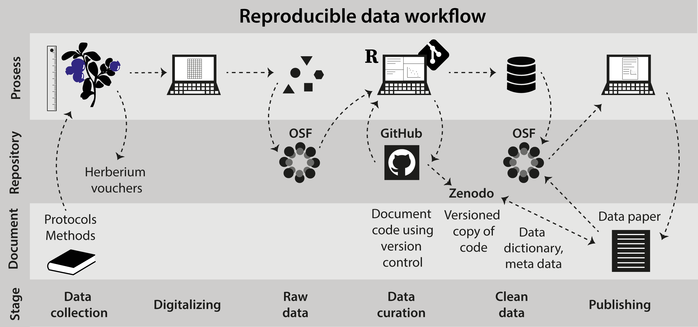

``` {r setup, include=FALSE}
knitr::opts_chunk$set(echo = FALSE)
```

# Reproducible workflows

```{=html}
<div class="model-signs" aria-label="Where this sits in the PFTC model">
<span class="sign sign-process">Process</span>
<span class="sign sign-share">Share</span>
<span class="sign sign-methods">Methods and technology</span>
</div>
```

Reproduciblitiy ...


```{r icons, out.width='100%'}

```

